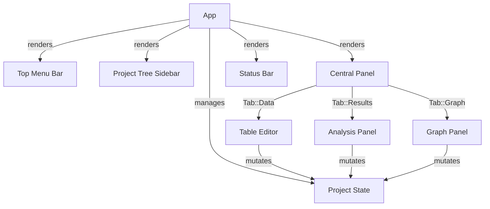

# UI Orchestrator (`src/ui/mod.rs`)

The UI layer of Aurora is implemented as a desktop application using [egui](https://github.com/emilk/egui) and [eframe](https://github.com/emilk/egui/tree/master/crates/eframe). It follows a state-driven, immediate-mode rendering pattern where the UI is reconstructed every frame based on the current state of the `Project`.

## Architecture Overview

The UI is divided into a main orchestrator (`App`) and three specialized functional panels:
- **Table Editor**: For raw data entry and management.
- **Analysis Panel**: For configuring and viewing statistical test results.
- **Graph Panel**: For visualizing data and results.

## The App Orchestrator

The `App` struct is the central state machine. It manages the lifecycle of the project, navigation, and application-wide settings.

### State Management
- **`Project`**: The core data model containing tables, analyses, and graphs.
- **`Tab`**: Controls which central panel is currently visible (`Data`, `Results`, or `Graph`).
- **`selected_*`**: Indices for the currently active table, analysis, or graph.
- **`revision`**: A monotonically increasing counter. It is bumped whenever data or options change, signaling the `GraphPanel` to invalidate its texture cache and re-render.
- **`Dialog`**: An enum representing the currently open modal window (e.g., `Open`, `SaveAs`, `ImportCSV`).

### Layout Structure
The application uses a classic IDE-style layout:
- **Top Panel**: Contains the menu bar (File, Table, Analyses, Graph, Settings, Help) and tab selection.
- **Side Panel**: The "Project Tree" allowing quick switching between tables, analyses, and graphs.
- **Central Panel**: Dynamically switches between the three functional panels based on `App::tab`.
- **Bottom Panel**: A status bar displaying the current operation result and project summary.

### Dialog System
Dialogs are implemented as temporary state overrides in the `App` struct. When `App::dialog` is not `None`, a modal `egui::Window` is rendered. Actions within dialogs (like "Import") are processed by the `App` and then the dialog is reset to `None`.

## Utilities and Theming

### Theming
The application supports Light and Dark modes. This is handled via `apply_theme`, which modifies the `egui::Visuals` of the context.

### Color Helpers
To ensure accessibility across themes, the UI uses custom color functions:
- `error_color(ui)`: Returns a red that remains legible on both dark and light backgrounds.
- `success_color(ui)`: Returns a green for successful operations.

### Slugification
The `slug()` function converts human-readable labels into filename-safe strings (e.g., `"My Data Table"` $\rightarrow$ `"my_data_table"`), ensuring consistent file exports.
